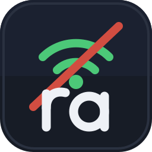

<p align="center">
  
</p>

# ra-offline — RetroAchievements offline proxy for the Nintendo Switch

[](LICENSE)

**ra-offline** is a background system module (sysmodule) for Nintendo Switch
[Atmosphere CFW](https://github.com/Atmosphere-NX/Atmosphere) that lets
RetroArch keep earning RetroAchievements **without an internet connection**.

It runs a tiny web server on the Switch itself that pretends to be
retroachievements.org. While you play offline, RetroArch doesn't notice any
difference — achievements you unlock are saved to the SD card. The moment
your Switch sees Wi-Fi again, ra-offline quietly uploads everything you
earned to the real retroachievements.org. Nothing is faked in your final
profile: every unlock is replayed to the real server.

## How it works

```
offline:  RetroArch ──> ra-offline (127.0.0.1:8080) ──> SD card queue
online:   ra-offline  ────────────────────────────────> retroachievements.org (TLS)
```

- RetroArch is pointed at the local proxy with a single config line
  (`cheevos_custom_host`).
- Game data (login, game identification, achievement definitions) is served
  from a cache on the SD card. A game must be in that cache **before** you
  go offline (see [step 4](#4--cache-your-games-before-you-go-offline)).
- Unlocks are appended to a queue file and acknowledged to RetroArch
  immediately, so gameplay is never blocked.
- When the Switch comes online, the queue is replayed to the real server
  over the console's own TLS. Failed uploads stay queued and retry later.
- Uploads identify themselves with a unique `ra-offline` user agent tag,
  so RetroAchievements can tell them apart from live RetroArch traffic.
- RetroAchievements requires the module to drop queued unlocks after
  7 days, sent or not. Achievement logic changes often, and older
  unlocks may no longer match it. Connect at least once a week.

## Requirements

- Nintendo Switch running Atmosphere custom firmware
- RetroArch for Switch (standard build) with RetroAchievements enabled and
  logged in
- A [retroachievements.org](https://retroachievements.org) account
- A computer, once, to save your account file on the SD card
- Wi-Fi on the Switch at least once per game, to cache it before you play
  it offline

## Setup

### 1 · Save your account (on your computer, online)

```sh
git clone https://github.com/cheasan/switch-retro-offline
cd switch-retro-offline/tools

# save your account only (enough if you cache games on the Switch, step 4):
python3 fetch-cache.py --user YOUR_RA_NAME --password YOUR_RA_PASSWORD

# or also cache one game and link it to your ROM's achievement hash:
python3 fetch-cache.py --user YOUR_RA_NAME --password YOUR_RA_PASSWORD \
    --game 1234 --hash <md5-hash>:1234
```

The hash RetroArch sends is **not** always the plain MD5 of the ROM file.
The reliable way to get it: launch the game in RetroArch once with
achievements enabled (online), then copy it from RetroArch's log — the line
looks like `cheevos hash: <md5>`.

This produces an `ra-offline` folder (account + game cache) — by default at
`sd/switch/raoffline/` inside the repo, ready to copy. The Switch apps need
its `account.json`: it holds your user name and login token.

### 2 · Install the sysmodule

Download `ra-offline-vX.Y.Z.zip` from this repo's
[Releases](https://github.com/cheasan/switch-retro-offline/releases). Copy
its `atmosphere` and `switch` folders to the root of your SD card (merge
with the folders already there):

```
atmosphere/contents/4300000000000042/exefs.nsp     <- the sysmodule
atmosphere/contents/4300000000000042/toolbox.json
atmosphere/contents/4300000000000042/flags/boot2.flag
switch/ra-offline-cacher/ra-offline-cacher.nro     <- the cacher app (step 4)
switch/raoffline/...                               <- from step 1
```

Reboot the console. Atmosphere starts the module at boot; it logs to
`/switch/raoffline/sysmodule.log` if you want to confirm it's alive.

### 3 · Point RetroArch at the proxy

On the SD card, edit `retroarch/retroarch.cfg` (or use the helper script
against a mounted SD):

```sh
bash tools/ra-config.sh /path/to/sd/retroarch/retroarch.cfg
# adds: cheevos_custom_host = "http://127.0.0.1:8080"
```

Restart RetroArch (it reads the config once at boot). To go back to the
real server any time: `ra-config.sh <cfg> --restore`.

### 4 · Cache your games before you go offline

> [!IMPORTANT]
> Offline, ra-offline can only answer for games that are already in its
> cache. It cannot download anything without internet. If you start a game
> it has never seen, RetroArch shows
> *"Not cached offline. Play this game once online to cache it."* and you
> earn no achievements in that session. You cannot fix this while you are
> offline.

There are three ways to put a game in the cache. All of them need internet.

| Way | What you do | Best for |
|---|---|---|
| **Play it once online** (recommended) | Start the game in RetroArch while the Switch has Wi-Fi. | Each game you plan to play |
| **ra-offline cacher app** | Run the app once. It caches every game on the SD card. | A full library, or new games you have not started yet |
| **`fetch-cache.py`** | Run the tool on a computer (step 1). | Advanced use |

**We recommend that you start each game once online before you take it
offline.** The sysmodule then caches the game on its own. That first launch
also proves that the whole chain works: RetroArch logs in, finds the game,
and loads its achievements. If something is wrong, you see it while you
can still fix it.

#### The ra-offline cacher app

Starting every game one by one takes a long time. The **ra-offline
cacher** app caches all your games in one run. You do not need to start
each game or restart the console. Run it while the Switch has Wi-Fi, for
example before a trip.

1. Check that `switch/ra-offline-cacher/ra-offline-cacher.nro` is on the
   SD card. The release zip puts it there (step 2).
2. Start it from the Homebrew Menu.
3. Press **A**.

The app looks in `/tico/roms`, `/roms` and `/retroarch/roms`. To add more
folders, list them in `/switch/raoffline/cacher-roots.txt`, one per line
(for example `sdmc:/my/roms`). It hashes each game the same way RetroArch
does, so the cache matches what RetroArch asks for. The app skips games
that are already cached, so a second run only fetches new games. Press **Y** to also
ask again about games that had no achievements last time.

Good to know:

- The app needs `account.json` from step 1.
- New cache files work at once. You do not need to reboot or restart
  RetroArch.
- Run the app again each time you add games to the SD card.
- Keep the Switch awake during the run. Sleep cuts the Wi-Fi and stops the
  download.
- Some games have no achievement set on retroachievements.org, for example
  most fan translations, ROM hacks and homebrew. The app lists them as
  "no achievement set". That is normal.
- The cacher checks that retroachievements.org knows each game. It does
  not test your RetroArch setup. Start one game online once to test
  that.

### 5 · Play offline

Just play. Unlocks are queued to `/switch/raoffline/queue.json` instantly
and RetroArch shows them as earned. If a game shows "Not cached offline",
cache it with one of the ways in step 4 the next time you have Wi-Fi.

### 6 · Come back online

Within seconds of the Switch connecting to Wi-Fi, queued unlocks are
uploaded and the queue file empties. Check your profile on
retroachievements.org. Uploads retry automatically, so a flaky connection
never loses anything. Leaderboard times sync the same way.

Queued unlocks live for 7 days. Sync within a week: after that the
module drops them, even if it never uploaded them. RetroAchievements
requires this, because achievement logic changes frequently.

## Troubleshooting

Read `/switch/raoffline/sysmodule.log` first. Each failed upload names the
step that failed, or quotes the server's error text.

- **"Password is required" or "Missing RetroAchievements account
  information":** RetroArch has no saved password. Recent RetroArch builds
  encrypt it in `retroarch/retroarch-keychain.cfg` with the key in
  `retroarch/retroarch-keychain.key`. Do not delete the key file: RetroArch
  then cannot read the saved password again. Set the proxy first, then log
  in again from RetroArch's Achievements settings.
- **"Not cached offline. Play this game once online to cache it.":** the
  game is not in the cache. Connect to Wi-Fi. Then start the game once, or
  run the cacher app (step 4). You do not need to reboot afterwards.
- **Black screen when a game starts:** the RetroArch menu and its cores
  come from different releases. Keep the menu (`switch/retroarch_switch.nro`)
  and the cores in `retroarch/cores/` from the same download.
- **"Login failed" with nothing in `sysmodule.log`:** RetroArch did not
  reach the proxy. Check that `cheevos_custom_host` is
  `"http://127.0.0.1:8080"` in the `retroarch.cfg` that RetroArch loads.

## Building from source

Install [devkitPro](https://devkitpro.org/wiki/Getting_Started) with the
`switch-dev` package group (devkitA64 + libnx), then:

```sh
make                    # builds ra-offline.nsp
bash test/run-tests.sh  # 79-check desktop test suite (no Switch needed)
```

The HTTP server, protocol mocking, caching and sync logic all run and get
tested on a normal Linux machine — only the thin service glue needs real
hardware.

## Credits

- **Design & direction:** [cheasan](https://github.com/cheasan) (project
  concept, development plan, hardware testing).
- **Implementation:** built end-to-end by an AI coding agent —
  **GLM (Z.ai)** driving [OpenCode](https://opencode.ai) — from the plan
  document through all five phases, including the desktop test suite.

## Disclaimer

This is an independent hobbyist tool. It is not affiliated with, endorsed
by, or connected to the RetroAchievements.org team, the RetroArch team,
Nintendo, or Team Neptune (Atmosphere). Use of a custom firmware sysmodule
is at your own risk; be considerate and honest about how you unlock
achievements — the queue syncs everything you earn, nothing more.

## License

[MIT](LICENSE)
